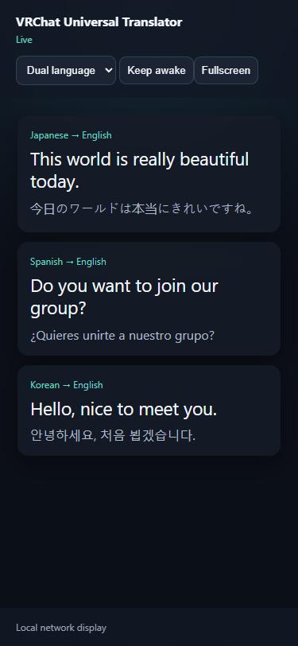

# VRChat Universal Translator

[Project case study](CASE_STUDY.md) · [Meet Alex Shade](https://github.com/Wommper1) · [The Level Everything Company](https://leveleverythingcompany.github.io/)

Live captions and English translation for VRChat, running entirely on your own Windows PC.

**[Download version 1.1.5 for Windows 11](https://github.com/Wommper1/VRChatUniversalTranslator/releases/tag/v1.1.5)** (free, early release). Then follow [Download and install](#download-and-install) below.

It listens to the audio that `VRChat.exe` plays (never your microphone), turns speech into text with a local Whisper model, translates it to English, and shows the captions in a click-through desktop overlay, on a SteamVR dashboard overlay, and, if you switch it on, on a phone on your home network.

> **Status: version 1.1.5, early release.** The build, 74 automated checks, the startup smoke test and the phone-server self-test pass, and the app has had a first real-world run with VRChat. Live VRChat sessions, a physical SteamVR headset, and a physical phone have **not** yet been through a full acceptance run, so the SteamVR overlay, speaker labels and phone display are best treated as experimental. [VERIFICATION.md](VERIFICATION.md) lists exactly what was and was not tested.

> **Source versus download:** the default branch includes development changes newer than v1.1.5. Use the release tag and its bundled documentation when checking what is in the downloadable package.

## Why it is safe to run

- **Local only.** No paid API, subscription, account, telemetry, or cloud processing. Audio and captions stay on your PC.
- **VRChat-only capture.** It uses Windows per-process audio capture on `VRChat.exe`; it never records your microphone and never injects into or modifies VRChat.
- **Nothing saved by default.** Raw audio is not recorded and transcripts are not stored. Caption history lives in memory and disappears when you close the app.
- **Downloads are checked.** Speech models are verified by exact size and SHA-256 before use; the optional Python tools are installed from hash-locked requirements. See [PRIVACY.md](PRIVACY.md) for every internet destination and [SECURITY.md](SECURITY.md) for the threat model.

## Features



- Live captions of VRChat speech, with auto-detected or locked source language, shown as `(auto)` or `(locked)`.
- Click-through overlay with adjustable size, background, and duration. Press **Ctrl+Alt+O** to unlock, drag or resize it, then again to lock it.
- Native SteamVR captions and dashboard controls (experimental).
- Output in other languages through optional offline language packs, and typed replies you can preview, edit, and copy. Sending a reply to VRChat over OSC is explicit and rate-limited.
- Editable word corrections and recognition hints; global shortcuts and a tray icon.
- Optional phone display on your local network, protected by a PIN that changes every time it is turned on (off by default). The picture shows it with made-up sample captions.
- Optional session-only speaker labels (off by default, experimental).
- Optional **fast English captions** (off by default, experimental): a one-time download of about 180 MB lets English speech be captioned about half a second to a second after it ends, instead of about two. Other languages and all translation still use Whisper. See Settings.
- CPU only. There is no GPU backend in this version.

## Download and install

You do not need to build anything.

1. Open the [version 1.1.5 release page](https://github.com/Wommper1/VRChatUniversalTranslator/releases/tag/v1.1.5) and download `VRChatUniversalTranslator-1.1.5-win-x64-portable.zip` and `SHA256SUMS.txt`.
2. Check the download. In PowerShell:
   ```powershell
   Get-FileHash .\VRChatUniversalTranslator-1.1.5-win-x64-portable.zip -Algorithm SHA256
   ```
   The hash must match the line for that file in `SHA256SUMS.txt`.
3. Extract the whole ZIP to a folder and keep the files together. The build is self-contained; no separate .NET install is needed.
4. Double-click `VRChatUniversalTranslator.exe`. The app is not code-signed, so Windows SmartScreen may show "Windows protected your PC" the first time; use **More info**, then **Run anyway**, only after the hash matches. Microsoft Defender may also check an unfamiliar program in the cloud for a moment the first time; that is expected for new software and is not a detection.
5. **Download the speech model before expecting captions.** In **Settings**, choose **Balanced** and click **DOWNLOAD SELECTED MODEL** once (about 148 MB). Until you do, listening produces no captions. After that, captioning works offline.

Requirements: Windows 11 x64, and the Microsoft Visual C++ 2015-2022 x64 Redistributable (normally already installed on gaming PCs). `VRChat.exe` is needed only for live use.

Start with [QUICK_START.md](QUICK_START.md).

## Everyday use

1. Start VRChat, then start the app (one copy at a time).
2. Confirm the detected VRChat process and choose a mode. Balanced is the default; other modes offer their own model download when selected.
3. Click **Start Listening**. The model detects the language and translates to English locally.
4. Optionally click **Start Phone Display** and open the displayed link on a phone on the same private network. The link carries a six-digit PIN that is new each time; the server refuses other networks and wrong PINs, is read-only, and stops when the app exits. It uses plain HTTP, so use it only on a network you trust.

Balanced mode is tuned for responsive conversation: short utterance boundaries, one-pass language reporting, a bounded two-item queue, and language stabilization that prevents a single noisy phrase from relabeling the conversation.

## Responsible use

The app turns other people's speech into text, so please use it considerately.

- Tell the people you are talking to that you use live captions, especially if you turn on the phone display or show captions to anyone else.
- Some worlds, groups and events do not allow recording or transcription. Follow their rules and VRChat's own [Community Guidelines](https://hello.vrchat.com/community-guidelines).
- Captions are automatic estimates. They can be wrong, miss words, or mislabel a language. Do not rely on them for anything important.
- Nothing is saved unless you choose to save it, and audio and captions never leave your PC over the internet. The only exception you control is the optional phone display, which shows captions on devices on your own network. What you do with captions is your responsibility.

## Updating

Download the new ZIP, extract it to a new folder, and run it. Your settings, downloaded models and language packs live in `%LOCALAPPDATA%\TheLevelEverythingCompany\VRChatUniversalTranslator`, outside the app folder, so they carry over. Delete the old folder when you are done.

## Help and bug reports

[Open an issue](https://github.com/Wommper1/VRChatUniversalTranslator/issues/new/choose) on this repository and fill in the template. For a security problem, follow [SECURITY.md](SECURITY.md) instead of opening a public issue. Everyone taking part is expected to follow the [Code of Conduct](CODE_OF_CONDUCT.md).

## Build from source

You need Windows 11 x64 and the [.NET SDK](https://dotnet.microsoft.com/download/dotnet) version in `global.json`. No CMake or C++ compiler is required; Whisper.net's packaged native CPU runtime is used.

```powershell
dotnet restore .\VRChatUniversalTranslator.slnx --configfile .\NuGet.Config
dotnet build   .\VRChatUniversalTranslator.slnx --configuration Debug --no-restore
dotnet run --project .\src\VRChatTranslator.App\VRChatTranslator.App.csproj
```

Checks (all run without VRChat, a headset, or audio hardware):

```powershell
dotnet run --project .\tests\VRChatTranslator.Core.Tests\VRChatTranslator.Core.Tests.csproj           # automated checks
dotnet run --project .\src\VRChatTranslator.App\VRChatTranslator.App.csproj -- --smoke-test          # WPF startup
dotnet run --project .\src\VRChatTranslator.App\VRChatTranslator.App.csproj -- --phone-self-test     # phone server
```

`scripts\build-release.ps1` produces the portable ZIP in `artifacts\`. See [BUILD.md](BUILD.md) for details and [CONTRIBUTING.md](CONTRIBUTING.md) before sending changes.

## Repository layout

```text
src/
  VRChatTranslator.App/      WPF window, overlay, SteamVR captions, phone display server, monitoring
  VRChatTranslator.Audio/    Windows process-loopback capture and diagnostic WAV
  VRChatTranslator.Core/     models, settings, paths, download checks, phone-display rules
  VRChatTranslator.Speech/   local Whisper model manager, VAD, translation pipeline
assets/                      app icon and its source design
config/                      editable example settings; your real settings are never committed
models/                      where model instructions live; model files are downloaded, not committed
scripts/                     build, setup, and icon scripts; hash-locked Python requirements
tests/                       automated checks
```

## Documentation

| Document | What it covers |
| --- | --- |
| [QUICK_START.md](QUICK_START.md) | First run, controls, replies, phone display |
| [PRIVACY.md](PRIVACY.md) | What is stored, what is downloaded and from where |
| [SECURITY.md](SECURITY.md) | Threat model, safeguards, how to report a vulnerability |
| [ARCHITECTURE.md](ARCHITECTURE.md), [BUILD.md](BUILD.md) | How it is built and why |
| [LANGUAGE_PACKS.md](LANGUAGE_PACKS.md) | Optional offline language packs |
| [VERIFICATION.md](VERIFICATION.md), [ACCEPTANCE_CHECKLIST.md](ACCEPTANCE_CHECKLIST.md) | What was tested, and what still needs a real VRChat session |
| [RELEASE_NOTES.md](RELEASE_NOTES.md), [RELEASE_STATUS.md](RELEASE_STATUS.md) | What is in each release |
| [TODO.md](TODO.md) | Requirements tracker with evidence per item |

## License and notices

Released under the [MIT License](LICENSE), Copyright (c) 2026 The Level Everything Company. Bundled and downloaded third-party components keep their own licenses; see [THIRD_PARTY_NOTICES.md](THIRD_PARTY_NOTICES.md).

This is an independent project. It is not affiliated with, endorsed by, or sponsored by VRChat Inc. "VRChat" is a trademark of its owner.
